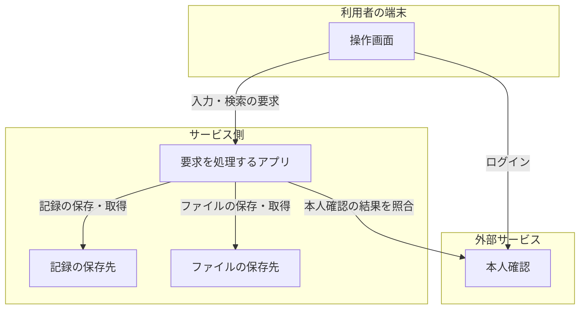

# 同じシステム構成を、立場に合わせて説明する

## 2026年10月21日 GitDiagram方式への変更

本人が、GitDiagramを出発点にして、同じ構成から立場別に説明し、疑問・検証・改善へつなぐ方針を指定した。一般的な役割名に置き換える静的な分類だけでは、システム固有の意味を説明できていなかった。

利用者向けの図生成は、READMEとコードの抜粋をAIが読み、目的・利用者・業務上の処理・保存先・関係を構造化する方式へ置き換えた。Rustが構造と参照行を検査して保存し、同じモデルを立場に合わせて説明する。APIキーは開発者・運営者がサーバーへ設定し、利用者に入力を求めない。運営者用CLIでの接続確認、図の部分に対応するAIへの質問、保存した図の版への復帰を接続する。DADSを引き続き使う。

これは実装した方式の変更で、PRの採用・実モデルの品質・利用者の理解を確認済みとするものではない。合成応答による動作の確認と、キー設定後に必要な実モデルの品質確認を分ける。[実装と操作](repository-architecture.md)と[確認記録](validation-ai-architecture-2026-10-21.md)を参照する。以下の静的な分類に関する記述は変更前の経緯を含む。

2026年10月21日の本人の指摘を受けた設計修正。#167・PR #168の完了条件を修正する資料であり、この資料の架空の図を対象の構成へ流用しない。実装した静的な抽出と説明、未対応の範囲は[実装資料](repository-architecture.md)を参照する。

## 本人が求めているもの

GitHubリポジトリから、システム全体の構成とつながりが分かる1枚の図を作る。その同じ構成を、非技術者には役割や情報の流れから説明し、技術者には技術や接続の詳細まで説明する。双方が同じ図を基に、不安や疑問を整理し、検証・改善へ進む。

箱の名前を平易にするだけでは足りない。全体の中で何を担う部分か、どこと何をやり取りするか、その関係から何を確認したいかが分かる必要がある。参考に示されたAWSの図は構成と関係を表す例であり、対象をAWSへ限定する指示ではない。

## 訂正前の実装の誤り

`src/reader/repository_map.rs` は最大18個のソースファイルを箱にし、import等の参照宣言を線にしている。`ui/repository-diagram.js` はそれを2列に並べ、立場によってファイル名と一般的な入出力ラベルを切り替えている。

この表示では、実行されるアプリ、保存先、外部サービス、それらの境界やデータの流れを特定できない。「データの読み書き・結果の表示」のような名前の箱が並んでも、そのシステムの役割は説明できない。これはコードの参照図の試作であり、本人が求めたシステム構成図の要件を満たさない。「候補」「未確認」と注記しても、構成要素の単位の誤りは解消しない。

ファイルや関数の参照は、構成要素の説明の根拠としてたどれる詳細に位置づける。

## 共通の構成と、説明の詳しさ

以下は表示の違いを説明するための架空のWebシステムの例。実際に読み込んだリポジトリの構成として流用しない。

| 共通して指す部分 | 非技術者への説明 | 技術者への詳細 |
| --- | --- | --- |
| 操作画面 | 利用者が入力し、結果を見る場所 | UIの実装技術、配信方法、接続先API |
| 要求を処理するアプリ | 入力を受け、必要な情報を保存・取得して返す | サービスとプロセスの構成、API、処理の境界 |
| 記録の保存先 | 入力した記録が残る場所 | DBの種類、接続設定、読み書きするデータ |
| 外部の本人確認 | ログインした人を確かめる仕組み | 認証サービス、認証の方式、トークンの受け渡し |
| 画面からアプリへの線 | 何を依頼し、何が返るか | 通信方向、プロトコル、エンドポイント、データ形式 |

これは、実装側で採る設計案である。

- 構成要素と接続を共通の識別子で持つ。表示を切り替えても、選んだ部分・疑問・検証との対応を保持する。
- 全体図を基本にし、役割が分かる名前、意味の分かる接続ラベル、端末・アプリ・外部サービス等の境界を示す。
- 非技術者には関連する内部要素を役割ごとにまとめる。技術者には同じ部分の内部構成、技術名、通信・配置の詳細を展開する。まとめた部分と内部要素の対応を保持する。
- 同じ部分の位置とつながりを保ち、詳しく読む操作から全体へ戻れるようにする。大量の図・要素・接続をメニューから選ぶ操作を前提にしない。
- 箱だけでなく接続にも説明と根拠を持たせる。疑問は構成要素、接続、全体のいずれにも結びつけられるようにする。

技術名やプロトコルは、根拠がある場合に表示する。非技術者向けにまとめるときも、外部へ渡る情報や保存先など、疑問を考えるために必要な境界を隠さない。

## 設計訂正で必要とした変更

コードの入出力検出だけを増やす方針は採らない。READMEなどの説明、起動設定、サービス定義、コンテナ・インフラ設定、APIの呼出しや保存処理を対応づけて、構成要素と関係を特定する。

訂正前の読取は対応ソース・README・一部のマニフェスト等に限られ、Composeやインフラ定義を優先して読む処理も不足していた。読取範囲と、役割・接続を持つモデルの生成を変更した。現在の対応範囲と未対応の構成は実装資料に記載する。

1. 既存の `src/architecture.rs` が持つ要素・親子関係・接続・根拠・版を確認し、リポジトリ由来の構成へ共用する範囲を決める。見本の選択画面を再導入することとは分ける。
2. 説明・設定・コードを横断して、サービスや役割の単位にまとめる。依存ライブラリの存在だけから、稼働するサービスや実際の配備先を断定しない。
3. 各要素と接続へ、固定コミットの複数の根拠と、設定の記述・作者の説明・推定の区別を保持する。実行による確認とは別にする。
4. 共通の構成から、全体図と立場に応じた説明を生成する。要素をまとめたり展開したりしても、元の構成と疑問の対応を失わない。
5. 読み取れない部分は対象箇所に示す。構成が特定できない場合、無関係なファイルの箱を並べて完成扱いにしない。

AIを構成の抽出や説明にも使うか、どの範囲を静的解析で担うかは、これから実装・比較する選択である。現時点で方式の採用や品質確認が済んだとは扱わない。本人が今後組み込むと指定した不安・疑問の対話とは分けて記録する。

## 完了を判断する条件

- 図を見て、主な役割、保存先、外部とのやり取り、システムの範囲を説明できる。
- 箱は対象のサービスや責務を表し、線は何がどこへ渡るかを表す。ファイルを箱にし、importを通信へ読み替えるだけでは通過しない。
- 根拠を確認できる対象リポジトリで、人が整理した構成と出力を照合する。要素数や描画成功だけで合格としない。正解を固定できる架空の複数サービス構成と、外部サービスのない単一アプリも用いる。
- 両方の立場で同じ部分を説明し、詳細の展開後も全体との位置関係が分かる。表示の変更で疑問・期待・結果を取り違えない。
- 要素と接続から疑問を残し、検証条件・結果・改修後の確認へたどり、同じ構成へ戻れる。
- 未読・推定・未確認が説明に反映され、設定の存在と実行結果が区別される。
- 初めて見る人による理解と操作の評価を、自動試験とは別に記録する。

設計訂正前のPR #168の操作試験は、入力・保存・移動・表示切替等を確認した記録として保持する。構成の意味の正しさを検査していないため、上の構成図の要件の達成根拠にはしない。#167は未完了のまま継続する。

## 本人が示した参考資料

- [Qiita：システム開発でよく使われる図のまとめ](https://qiita.com/kimdev/items/903bb4b2754705af94d5) — 構成要素、責務、通信経路を俯瞰する図と、他の図の目的の違い。
- [Zenn：システム構成図の書き方](https://zenn.dev/maman/articles/a797a98ac548e9) — 主要な構成要素と関係、役割、適切な抽象度、全体からの詳細化。
- [Lucid：アーキテクチャ図作成方法と作成ツール、書き方の紹介](https://lucid.co/ja/blog/how-to-draw-architectural-diagrams) — システム全体の構造、境界、相互作用、説明のための注釈。
