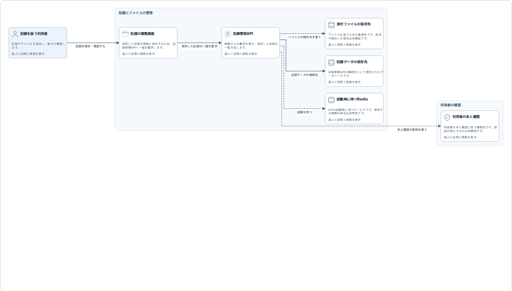
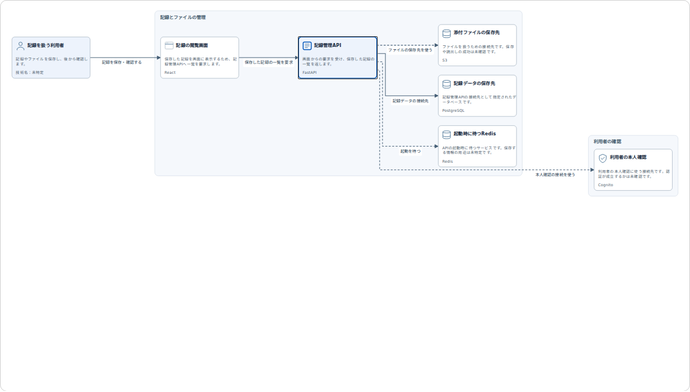

# GitDiagram方式への変更と確認記録

2026年10月21日。対象はPR #168の追加変更。本人がGitDiagramを出発点にする方針を指定し、APIキーを設定して実モデルで試したいと伝えたことを受けて実装した。

## 変更した動作

利用者向けの構成図は、静的な種類の分類から、READMEとコードの抜粋をAIが読んで、そのシステム固有の役割と関係を整理する方式に変更した。GitDiagramの構成把握の指示を日本語で翻案し、MIT Licenseと参照元を保持した。Webサービス自体やMCPの接続ではなく、このリポジトリ内で生成と検査を行う。

本人の追加指示に従い、APIキーは開発者・運営者がサーバーへ設定する方式へ修正した。`ai init`で所有者だけが読み書きできるひな形を作り、エディタで記入後、`ai test`で短い問い合わせを確認する。利用者向けのキー入力欄、設定変更・接続確認のHTTP APIは削除した。キーはモデルへの文脈や画面に含めない。AIへのHTTP通信をRustに移し、Node.jsを必要としない。

目的と主な情報の流れを図の上に表示する。同じ要素・接続・配置で説明を切り替える。図の部分と関連するコード・設定からAIへ質問できる。疑問と検証内容を保存し、詳細画面から疑問を残した図の版へ戻れる。

## 自動確認と画面の確認

Rust 1.99.0で143件成功、既存の重いコンテナ等の4件は除外。fmt/check/test/clippy/buildが成功した。新しい構成モデルの4件とアプリの追加3件で、渡していない行の参照、重複ID、存在しないパス、接続先の欠落、実装の変更に応じた図の版、長いソースの分散抜粋、保存した図の再表示、接続設定の保護、初期化の上書き拒否、不完全な環境変数の拒否、完全な環境変数の優先を確認した。

`npm run test:reader`と`npm run test:reader-native`が成功した。読取・解析の既存APIを維持する。

`npm run test:journey`では実Rustサーバーとローカルの合成AIサーバーを使い、次を確認した。

- 未設定時は生成しない。運営者用CLIでの設定ファイル作成・接続確認後に再起動し、利用者のキー入力なしで生成する。
- 画面にキー・モデル・接続先の入力欄がなく、設定変更APIと設定ファイルのHTTP取得を404で拒否する。設定・エラー・モデルの文脈にキーを含めない。
- 未読の参照を返す応答へ修正を求め、修正後に表示する。
- 利用者と業務上の機能、実際のサブシステム、根拠と推定を含む同じ構成を表示する。
- 箱と線をキーボードで選び、対象別の下書きを保つ。競合時にも疑問を失わない。
- AI回答だけでは発言・期待・試験結果を保存しない。
- 再生成に失敗しても成功した図を残す。再生成後も、検証画面から疑問を残した以前の図へ戻る。
- 立場の切替で配置や事例の記録を変えない。ページの再読込で再生成しない。
- 図全体が表示領域に収まり、線の両端が正しい箱に接する。幅1440/390/320pxと文字200%で本文が横へはみ出さない。

サーバーのPATHからNode.jsを除いた状態で、生成・接続確認・疑問のAI整理まで通した。Playwright 1.62.1と公式Chrome Headless Shell 141.0.7390.122を使った。CIの固定Chromium 151とは区別する。

DADSの部品とトークンを継続し、日本語はyomiyasuで点検した。図の画面写真は合成応答による表示例であり、実モデルが出した図の例とは扱わない。

## 未確認の範囲

この環境には実モデルのAPIキーがない。実モデルでの生成、説明の正しさ・網羅性、処理時間・費用、実際の利用者の理解と判断は未確認。GitDiagramと同等の生成品質も確認していない。キー設定後は、本人が例示した患者情報共有システムなどの固定版から生成し、根拠と図を照合する必要がある。

`npm run test:app`の公開GitHubを使う既存の試験は、存在しないリポジトリの確認時にGitHub APIから利用上限またはアクセス制限が返り、その先へ進めなかった。今回の成功件数に含めない。以前の実行結果と、今回の合成応答による画面確認を混同しない。

既存のOpenEMR・OHIF・MONAIの重いコンテナ試験はローカルで再実行していない。過去のPRのCI成功を、この変更のCI成功として扱わない。

## 読む順番

1. `docs/repository-architecture.md`で操作と範囲を確認する。
2. `src/system_diagram/prompt.txt`、`context.rs`でAIへ渡す指示と根拠を見る。
3. `model.rs`、`src/system_diagram.rs`で検査、共通モデルへの変換、保存と過去の図への復帰を見る。
4. `src/main.rs`、`src/ai/connection.rs`、`src/review.rs`、`ui/app.js`で運営者の設定と利用者の画面の動作を見る。
5. `tools/journey-smoke.mjs`で疑問・検証・元の図への往復を確認する。
