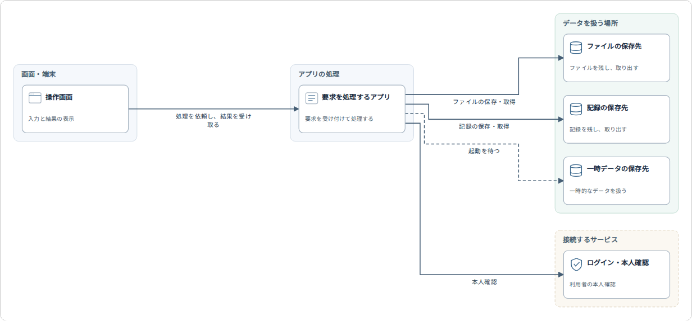
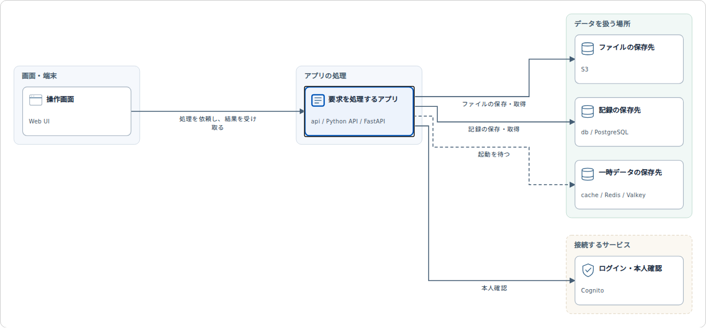

# システム構成図の抽出と説明の確認

対象はPR #168の、ファイル単位の参照図をサービスと役割・接続の図へ置き換える変更。図が表示されるだけで合格とせず、架空の構成の意味と出力を照合した。実参加者による理解の評価は未実施。

## 確認した構成

`tests/fixtures/reader/system.json`は、画面、FastAPI、PostgreSQL、Redis、Cognito、S3の6要素からなる架空のシステム。APIからDBへの保存・取得と、Redisへの起動依存を区別する。読み取った9ファイルを9個の箱にはしない。すべての根拠の行を固定版の本文へ照合した。

Rustの構成確認は、単一アプリと複数モジュール、複数アプリの区別、依存やコメントだけからサービスを作らないこと、SQLiteの代替設定とComposeを同時稼働として混ぜないこと、Composeの配列・辞書形式、内部ファイルの移動後の識別子、補助スクリプトとHTML画面、同じ行に言及された別の試作による誤分類を含む。

## 自動確認

Rust 1.99.0、Node.js 24.19.0、Playwright 1.62.1、公式配布のChrome Headless Shell 141.0.7390.122を使った。ブラウザは環境変数で実行ファイルを明示しており、CIの固定Chromium 151とは分ける。

- Rust 136件成功。Docker等を使う既存の4件は除外。fmt・check・test・clippyの警告をエラーにする確認・buildが成功。
- `npm run test:reader`は、既存の解析結果、呼び出し先、理解と比較の確認が成功。
- `npm run test:reader-native`は、サーバーのPATHからNode.jsを外して、既存の解析と構成抽出のAPIの成功を確認した。
- `npm run test:journey`は、役割と接続の意味、立場の変更後も同じ配置と記録を保つこと、内部の処理の説明、要素と接続への疑問、競合後の入力保持、検証設定から元の要素への復帰、異なるリポジトリの分離、拡大・全体表示を確認する。SVGの接続線の両端が、対応する箱の境界に接することも確認した。
- 1440px・390px・320px、文字200%を確認した。図は枠内でスクロールでき、ページ全体は横へはみ出さない。
- `npm run test:app`は、既存の正常・観測欠落・書込不可・改修後の再試験・比較、AI接続失敗、認証とOriginの検査が成功。
- `npm run test:ui`は、レビュー・探索・外部実行・実行中の表示・画面写真・既存のLikeC4の操作が成功。探索画面内の任意のライブ接続は未確認と報告され、別に成功した下記の実読取とは区別する。

## 公開リポジトリでの読取

対象プログラムとセットアップは実行せず、GitHubからの読取と図・説明の切替を確認する。

| 対象と固定コミット | 本文の読取 | 図にした関係と未確認事項 |
| --- | --- | --- |
| Suisan-neki/Concordia-vol.1・4abb6e8db6051c8c1658c690c2abed3c502bc123 | 47ファイル、構成候補の未読0 | HTML画面、FastAPI、PostgreSQL、ファイル、Redis。DB接続と起動依存を区別。読んだコードにも役割を特定していない部分がある |
| Suisan-neki/Concordia-Wave・58f70c724bed0f430fdb4059583a51b960aaeb50 | 72ファイル、構成候補の未読136 | Web画面、FastAPI、DynamoDB、CognitoのURL設定、説明資料で別の試作とされるPythonアプリ。完全なAWS構成の抽出ではない |

README・Compose・対応するコードの記述と出力を照合した。両立場で配置を保つこと、根拠の参照先が存在することを確認した。これは本文の存在の確認と静的な構成の照合であり、実際の配備・通信・保存・認証を検証した意味ではない。

任意の公開リポジトリの読取は、ビルド後に`node tools/architecture-live-smoke.mjs GitHubのURL コミット`で確認できる。画面写真と構成のJSONは`test-results/`へ保存する。

## 残る範囲

Composeのoverride合成、一般的なCDK・Terraformのリソースやネットワークの抽出、動的な接続先の解決、任意の言語・構文、過去の図の再表示は未対応。AI対話、任意アプリの自動準備・計測、実参加者による理解の評価は未実施。重いOpenEMR・OHIF・MONAIのコンテナ試験も今回はローカルで再実行していない。

旧実装の記録は[初回の検証と訂正](validation-repository-first-2026-10-21.md)に保持する。今回の結果だけで汎用版の完成や研究目的の達成とはしない。

日本語はyomiyasuの既存の使用コミット`60bf877a`で点検した。実装資料に指摘なし。確認項目の箇条書きと既存用語の「版」は文脈を確認して残した。
